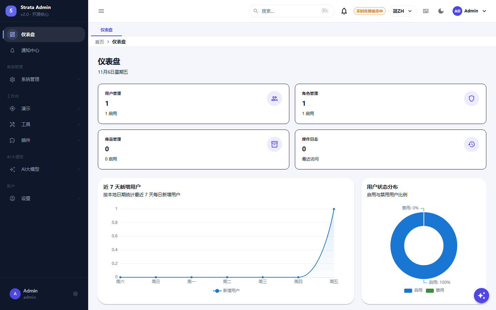
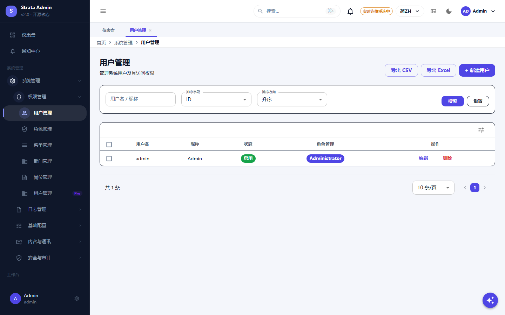
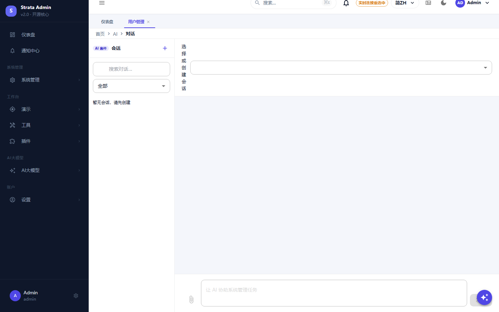

# Strata

[English](./README.md) | [简体中文](./README.zh-CN.md)

[](https://github.com/simplezac1995/strata/actions/workflows/ci.yml)
[](https://central.sonatype.com/artifact/io.github.simplezac1995/strata-spring-boot-starter)
[](LICENSE)

A modular-monolith backend framework for admin products: RBAC, operations, notifications, AI tooling and a plugin
SPI, with module boundaries enforced by Maven, Spring Modulith and ArchUnit.

Built on Spring Boot 4.1 and Java 25. Ships the backend framework, a React admin console and runnable examples.

## Try the demo

```bash
git clone https://github.com/simplezac1995/strata.git
cd strata
docker compose up --build
```

- Admin console: <http://localhost:3001> (login `admin` / `demo-admin-password`)
- API documentation: <http://localhost:8080/swagger-ui.html>

Local evaluation only — replace every demo secret before deploying.

## Screenshots

| Login | Dashboard |
| :---: | :---: |
|  |  |

| User management (RBAC) | AI chat |
| :---: | :---: |
|  |  |

Screenshots taken from the repository's own `docker compose` demo.
## Features

- **One dependency to start**: the starter auto-configures the system domain (RBAC, users, roles, menus, operations,
  configuration), its entities and repositories, security components, scheduling, Swagger UI and the database schema
  as a Flyway migration.
- **Explicit module boundaries**: Maven modules plus Spring Modulith and ArchUnit verification; cross-domain calls go
  through `*-api` contracts only.
- **Optional capabilities as modules or plugins**: AI (models, chat, knowledge bases), storage, payments, LLM gateways,
  Excel, field encryption and workflows are enabled by adding a dependency and a property, never by changing scans.
- **Host integration points**: `VerificationSender`, `BackupExecutor` and `AuditChangeApplier` ship safe defaults that
  a deployment replaces with its own beans.
- **Production plumbing included**: JWT/RBAC menu permissions, RFC 7807 errors, trace ids, rate limiting, idempotency,
  auditing, Flyway, CycloneDX SBOM, JaCoCo floors and a Dockerfile for the minimal application.
- **SSO / OIDC login**: authorization code + PKCE exchanged server-side, provider userinfo mapped to the normal JWT/RBAC session (auto-provision with a default role).
- **Admin console**: React 19 + MUI 9, RBAC-driven navigation, lazy routes, i18n, accessibility tests.

## Repository layout

| Path | Content |
| :--- | :--- |
| `strata/` | Maven reactor: framework modules, starter, plugins, generator, examples |
| `strata-ui/` | React admin console |
| `docs/` | architecture, conventions, adoption guide and generated configuration reference |
| `examples/` | minimal runnable application and the module golden path |
| `scripts/` | repository policy gates and the configuration-reference generator |

## Quick start

```bash
git clone https://github.com/simplezac1995/strata.git
cd strata/examples/strata-minimal-app
mvn spring-boot:run    # PostgreSQL 18 via STRATA_DB_* variables; Swagger at /swagger-ui.html
```

Or add the published starter to an existing application:

```xml
<dependency>
  <groupId>io.github.simplezac1995</groupId>
  <artifactId>strata-spring-boot-starter</artifactId>
  <version>0.4.0</version>
</dependency>
```

The starter ships the framework schema at `classpath:db/strata-framework`; keep that Flyway location and append your
own migrations. AI and generator modules auto-configure themselves when their dependencies are present.

## Documentation

- [Getting started](./docs/tutorials/getting-started.md)
- [Add a module](./docs/tutorials/add-a-module.md)
- [AI integration](./docs/tutorials/ai-integration.md)
- [How Strata compares](./docs/comparison.md)

- [Architecture](./docs/architecture.md)
- [Engineering conventions](./docs/conventions.md)
- [Adoption guide](./docs/adoption.md)
- [SSO / OIDC](./docs/sso-oidc.md)
- [Configuration reference](./docs/配置参考.md)
- [Contributing](./CONTRIBUTING.md) · [Security](./SECURITY.md) · [Changelog](./CHANGELOG.md)

## Build and test

```bash
cd strata
mvn -B verify                      # compile + tests + Spotless + ArchUnit + JaCoCo

cd ../strata-ui
pnpm install --frozen-lockfile
pnpm check                         # typecheck + lint + tests + i18n + formatting + build + bundle size
```

The exported repository is a single curated history of the framework; the private product repository that consumes it
is not part of this project.

## Versioning and releases

Semantic versioning with immutable Maven Central releases: pushing a `v*` tag runs the release workflow (GPG signing,
SBOM, Central Portal publish). See [CHANGELOG.md](./CHANGELOG.md).

## License

Apache License 2.0 — see [LICENSE](./LICENSE) and [NOTICE](./NOTICE).
