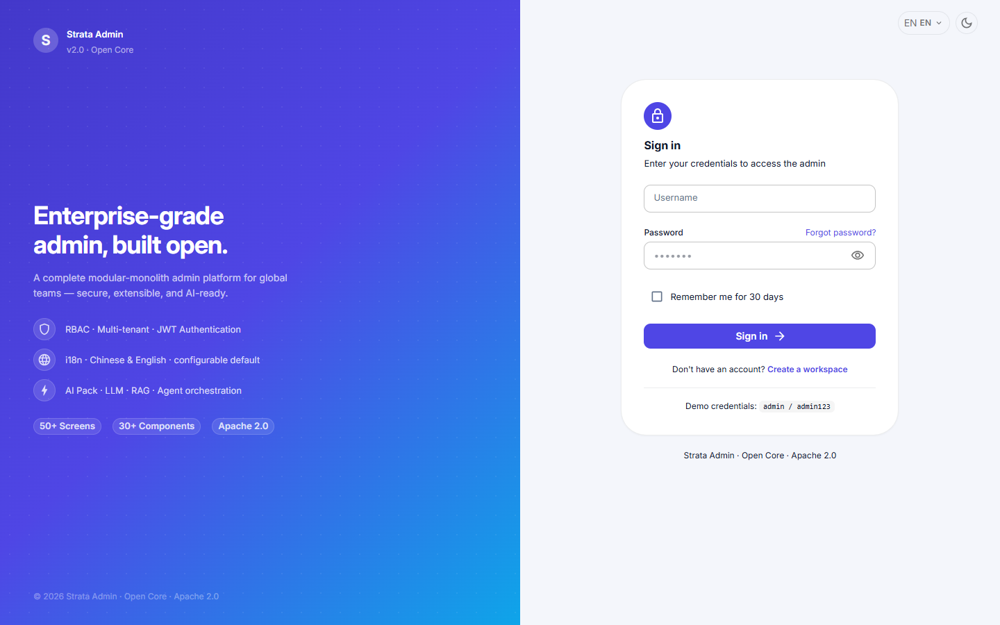
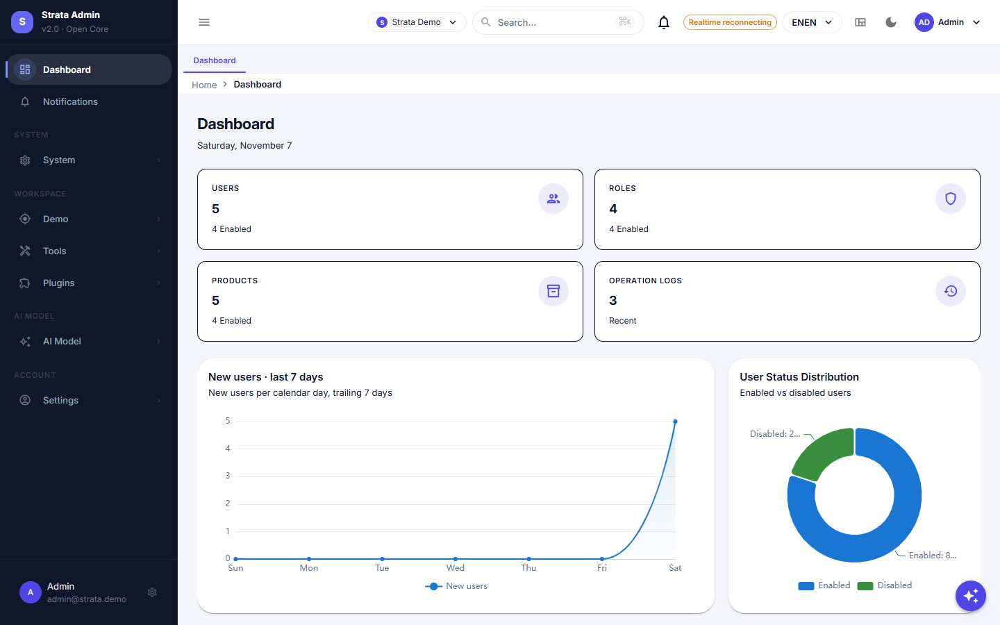

# Strata

[English](./README.md) | [简体中文](./README.zh-CN.md)

[](https://github.com/simplezac1995/strata/actions/workflows/ci.yml)
[](https://central.sonatype.com/artifact/io.github.simplezac1995/strata-spring-boot-starter)
[](LICENSE)

面向管理后台类产品的模块化单体后端框架：RBAC、运维、通知、AI 工具链与插件 SPI；模块边界由 Maven 模块、Spring Modulith
与 ArchUnit 强制校验，公开 CI 可自证。

基于 Spring Boot 4.1，**用 JDK 25 构建、在 Java 21+ 运行**（见[构建要求](#构建要求)）。仓库包含后端框架、React 管理端与
可运行示例。

> 名称说明：本项目与 OpenGamma 的 Strata（市场风险定价库）无关，只是同名。

## 在线体验

**在线实例：** <https://demo.simplecharlie.dev>，账号 `admin` / `admin123`（共享评估实例，数据每周重置（周日
03:30 UTC+8），请勿存放真实信息）。需要长期使用请本地起一份：

```bash
git clone https://github.com/simplezac1995/strata.git
cd strata
docker compose up --build
```

管理端 <http://localhost:3001>（admin / demo-admin-password），API <http://localhost:8080>，Swagger
<http://localhost:8080/swagger-ui.html>。

## 截图

| 登录 | 仪表盘 |
| :---: | :---: |
|  |  |

| 用户管理（RBAC） | AI 对话 |
| :---: | :---: |
|  |  |

| SSO 登录（Keycloak） | SSO 登录后的控制台 |
| :---: | :---: |
|  |  |

| SAML 登录（Keycloak） | SAML 登录后的控制台 |
| :---: | :---: |
|  |  |

| 在线 demo（登录页） | 在线 demo（Dashboard） |
| :---: | :---: |
|  |  |

截图来自仓库自带的 `docker compose` 演示环境；最后两张来自在线评估实例。

## 特性

- **一个依赖即可启动**：starter 自动装配系统域（RBAC、用户、角色、菜单、运维、配置）、实体与仓库、安全组件、调度与
  Swagger UI，并通过 Flyway 迁移交付数据库结构。
- **明确的模块边界**：Maven 模块 + Spring Modulith + ArchUnit 校验；跨域调用只能依赖 `*-api` 契约。
- **可选能力按模块/插件接入**：AI（模型、对话、知识库）、对象存储、支付、LLM 网关、Excel、字段加密、工作流；
  添加依赖 + 属性即可启用，无需修改扫描配置。
- **宿主集成点**：`VerificationSender`、`BackupExecutor`、`AuditChangeApplier` 自带安全默认实现，部署时声明
  同名 bean 即可替换。
- **生产级基础设施**：JWT/RBAC 菜单权限、RFC 7807 错误体、trace id、限流、幂等、审计、Flyway、CycloneDX
  SBOM、JaCoCo 覆盖门槛，以及最小应用的 Dockerfile。
- **SCIM 2.0 供应**：Okta / Entra ID / OneLogin 可通过受 token 保护的 SCIM 端点创建/更新/停用用户，并把组同步为
  RBAC 角色；支持 ETag/If-Match、复杂过滤与批量操作。
- **SSO / OIDC 登录**：授权码 + PKCE，服务端换取令牌，提供商 userinfo 映射为常规 JWT/RBAC 会话；provider groups
  可映射为 RBAC 角色（自动开户，可选每次登录同步）。
- **SAML 2.0 登录**：SP 发起式 SAML，XML-DSig 验签、基于 metadata 的 IdP 信任、按邮箱映射/自动开户，最终仍是同一套
  JWT/RBAC 会话；不依赖 OpenSAML。
- **TOTP MFA**：按用户可选开启的第二因素，密钥 AES-256-GCM 加密存储，支持二维码/手动绑定、登录二次校验，
  以及管理员审计重置。
- **管理端**：React 19 + MUI 9，RBAC 驱动导航、路由懒加载、i18n、可访问性测试。

## 仓库包含什么（版本边界）

| 路径 | 内容 |
| :--- | :--- |
| `strata/` | 框架多模块工程（common、system、ai、plugin、generator、starter、examples） |
| `strata-ui/` | React 管理端（含 PR 级门禁：类型、lint、格式、a11y、体积） |
| `deploy/` | 参考部署（`prod/`）、可观测性套件（`observability/`）与压测脚本（`testing/`） |
| `docs/` | 架构、工程规范、接入指南、部署运维、插件开发、代码生成器教程与自动生成的配置参考 |
| `scripts/` | 仓库策略门禁与配置参考生成器 |

社区版（Apache-2.0）不包含：业务垂直模块、私有产品与合规/支付相关的私有实现。Editions 说明见英文 README。

## 快速开始

### 构建要求

- 构建：**JDK 25**（唯一构建基线）；产物为 **Java 21 字节码**，可运行于 Java 21+。
- 依赖：PostgreSQL（唯一支持数据库）与 Redis。
- 前端：Node 22+ 与 pnpm 11。

```bash
# 后端（仓库根）
mvn -B verify                      # JDK 25 构建（Java 21 字节码）：编译 + 测试 + 格式化 + ArchUnit + JaCoCo

# 前端
cd strata-ui && pnpm install && pnpm check
```

### 本地起全栈

```bash
docker compose up --build
# 打开 http://localhost:3001 （admin / demo-admin-password）
```

## 接入已有应用

```xml
<dependency>
  <groupId>io.github.simplezac1995</groupId>
  <artifactId>strata-spring-boot-starter</artifactId>
  <version>0.11.5</version>
</dependency>
```

### 使用 BOM（Maven / Gradle）

Maven：

```xml
<dependencyManagement>
  <dependencies>
    <dependency>
      <groupId>io.github.simplezac1995</groupId>
      <artifactId>strata-bom</artifactId>
      <version>0.11.5</version>
      <type>pom</type>
      <scope>import</scope>
    </dependency>
  </dependencies>
</dependencyManagement>
```

Gradle：

```groovy
implementation(platform("io.github.simplezac1995:strata-bom:0.11.5"))
implementation("io.github.simplezac1995:strata-spring-boot-starter")
```

生产形态：参考部署与 TLS 见 `deploy/prod/`，可观测性套件见 `deploy/observability/`，压测脚本见
`deploy/testing/`（详见[部署](./docs/deployment.md)、[可观测性](./docs/observability.md)、[性能](./docs/performance.md)）。

starter 自带框架 schema（`classpath:db/strata-framework`），保留该 Flyway 目录并从 `V3` 起追加你自己的迁移。
AI 与代码生成器模块在依赖存在时自动装配。

## 文档

- [在线文档站](https://docs.simplecharlie.dev) · [离线文档](./docs/README.md) · [中文文档摘要](./docs/zh/README.md)
- [快速开始](./docs/tutorials/getting-started.md)
- [新增模块](./docs/tutorials/add-a-module.md)
- [AI 接入](./docs/tutorials/ai-integration.md)
- [代码生成器教程](./docs/tutorials/code-generator.md)
- [部署](./docs/deployment.md) · [运维](./docs/operations.md) · [可观测性](./docs/observability.md) · [安全加固](./docs/security-hardening.md)
- [升级与支持](./docs/upgrade-guide.md) · [多租户](./docs/multi-tenancy.md) · [性能基线](./docs/performance.md)
- [插件开发](./docs/plugin-development.md) · [SSO 厂商指南](./docs/sso-providers.md) · [API 客户端生成](./docs/api-client.md)
- [架构决策](./docs/decisions.md) · [治理](./GOVERNANCE.md) · [支持](./SUPPORT.md)

## 许可证

Apache License 2.0，见 [LICENSE](LICENSE) 与 [NOTICE](NOTICE)。
