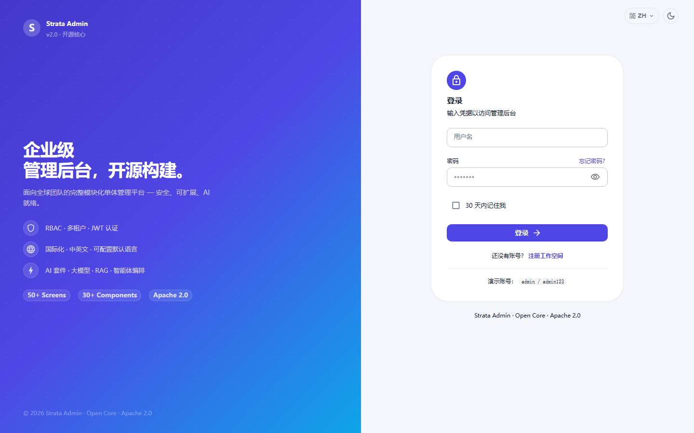
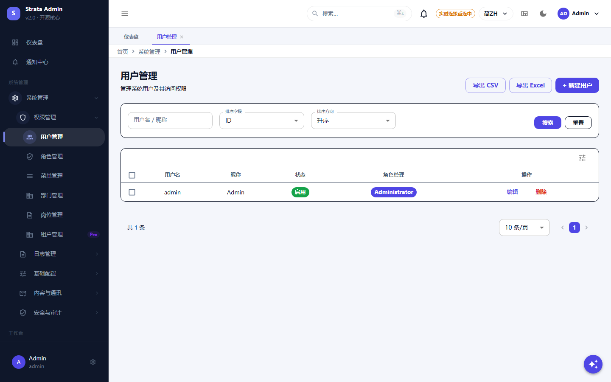
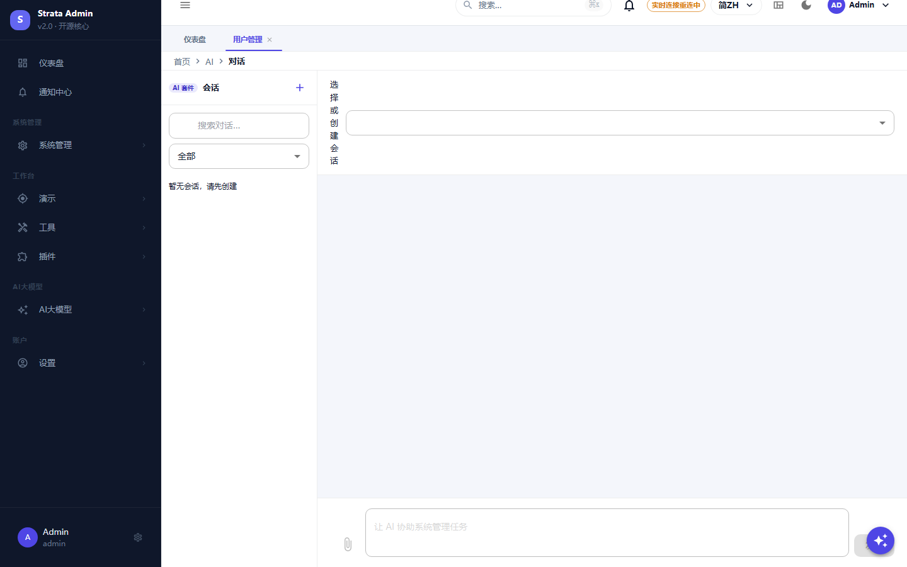
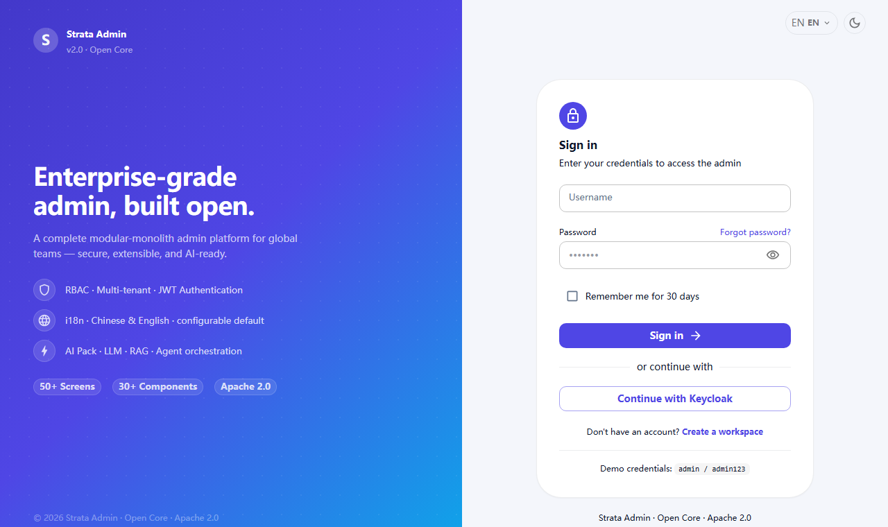
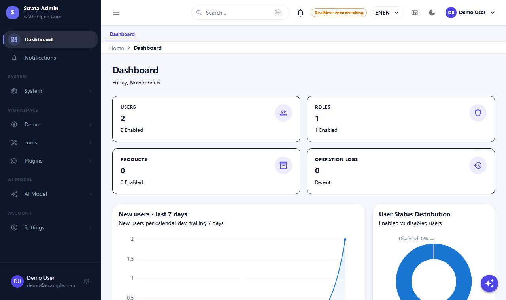
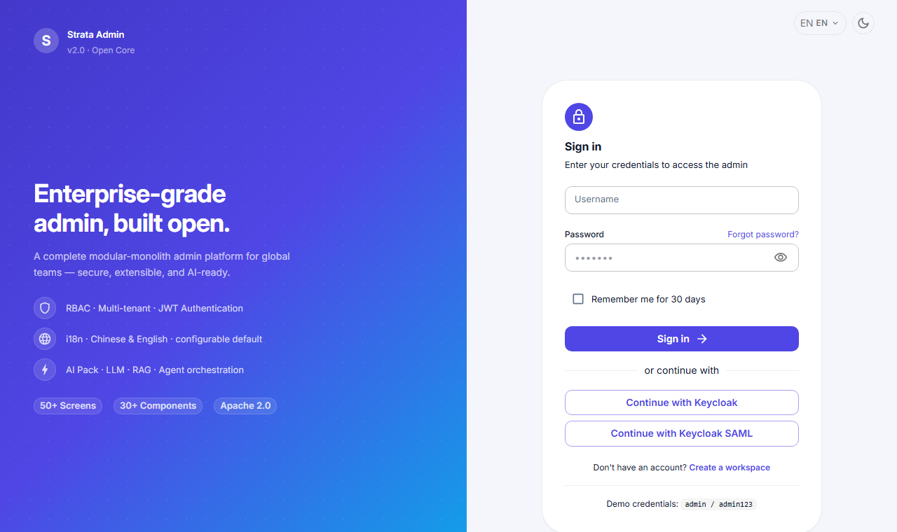
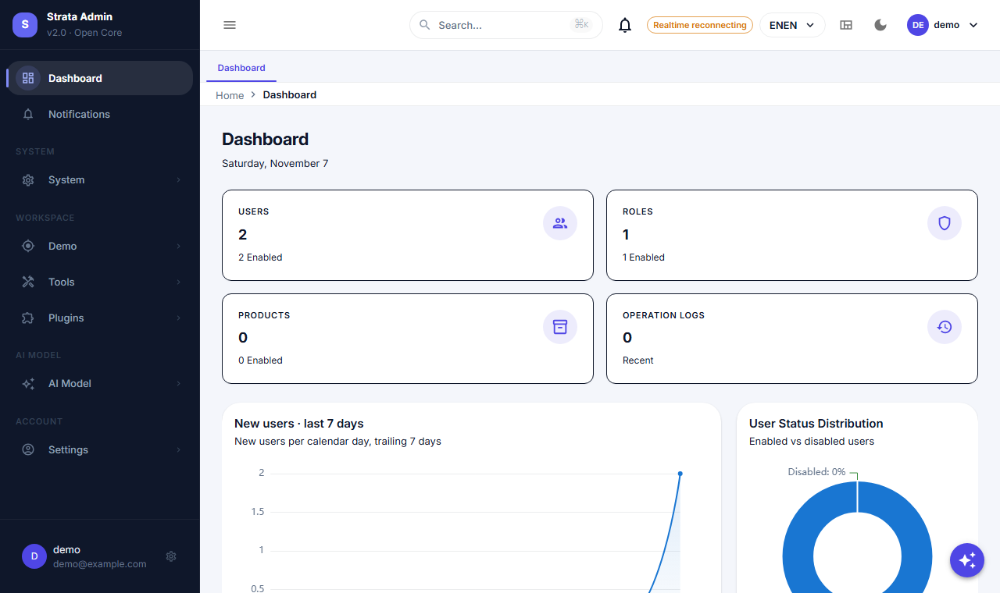

# Strata

[English](./README.md) | [简体中文](./README.zh-CN.md)

[](https://github.com/simplezac1995/strata/actions/workflows/ci.yml)
[](https://central.sonatype.com/artifact/io.github.simplezac1995/strata-spring-boot-starter)
[](LICENSE)

面向通用后台产品的模块化单体后端框架：RBAC、运维、通知、AI 工具链与插件 SPI，模块边界由 Maven、Spring Modulith
和 ArchUnit 强制约束。

基于 Spring Boot 4.1 与 **JDK 25**（唯一受支持的构建基线，见下文「构建要求」），包含后端框架、React 管理端和可直接
运行的示例。

## 一键 Demo

```bash
git clone https://github.com/simplezac1995/strata.git
cd strata
docker compose up --build
```

- 管理端：<http://localhost:3001>（账号 `admin` / `demo-admin-password`）
- API 文档：<http://localhost:8080/swagger-ui.html>

仅用于本地评估；部署前请更换所有 demo 密钥。可选的 Keycloak SSO 叠加：

```bash
docker compose -f docker-compose.yml -f docker-compose.sso.yml up --build
```

登录页点击 **Continue with Keycloak**（`demo` / `demo123`）。demo 用户通过 Keycloak group 映射为 `admin` 角色：


## 截图

| 登录 | 仪表盘 |
| :---: | :---: |
|  |  |

| 用户管理（RBAC） | AI 对话 |
| :---: | :---: |
|  |  |

| SSO 登录（Keycloak） | SSO 登录后的控制台 |
| :---: | :---: |
|  |  |
| SAML 登录（Keycloak） | SAML 登录后的控制台 |
|  |  |

截图来自仓库自带的 `docker compose` 演示环境。

## 特性

- **一个依赖即可启动**：starter 自动装配系统域（RBAC、用户、角色、菜单、运维、配置）、实体与仓库、安全组件、调度、
  Swagger UI，并以 Flyway 迁移交付数据库结构。
- **明确的模块边界**：Maven 模块 + Spring Modulith + ArchUnit 校验；跨域调用只能依赖 `*-api` 契约。
- **可选能力按模块/插件接入**：AI（模型、对话、知识库）、对象存储、支付、LLM 网关、Excel、字段加密、工作流，
  添加依赖 + 属性即可启用，无需修改扫描配置。
- **宿主集成点**：`VerificationSender`、`BackupExecutor`、`AuditChangeApplier` 自带安全默认实现，部署时声明
  同名 bean 即可替换。
- **生产级基础设施**：JWT/RBAC 菜单权限、RFC 7807 错误体、trace id、限流、幂等、审计、Flyway、CycloneDX
  SBOM、JaCoCo 覆盖门槛，以及最小应用的 Dockerfile。
- **SCIM 2.0 供应**：Okta / Entra ID / OneLogin 可通过受 token 保护的 SCIM 端点创建/更新/停用用户，并把组同步为 RBAC 角色；支持 ETag/If-Match、复杂过滤与批量操作。
- **SSO / OIDC 登录**：授权码 + PKCE，服务端换取令牌，提供商 userinfo 映射为常规 JWT/RBAC 会话；provider groups 可映射为 RBAC 角色（自动开户，可选每次登录同步）。
- **SAML 2.0 登录**：SP 发起式 SAML，XML-DSig 验签、基于 metadata 的 IdP 信任、按邮箱映射/自动开户，最终仍是同一套 JWT/RBAC 会话；不依赖 OpenSAML。
- **管理端**：React 19 + MUI 9，RBAC 驱动导航、路由懒加载、i18n、可访问性测试。

## 本仓库包含什么（版本边界）

Strata 采用 Open Core，边界可以在本仓库里核实：

- **Community —— 本仓库（Apache-2.0）**：框架模块、starter、插件 SPI、可运行示例，以及通用 React 管理端。
- **Pro / Enterprise —— 不在本仓库**：面向受监管业务的垂直模块。它们通过 Maven Central 消费已发布的框架；本仓库
  不依赖它们。
- **没有 SaaS 锁定**：这里发布的一切均为 Apache-2.0，可运行在自己的基础设施上；私有模块是独立的可选产品。

**Case study**：该框架已用于一个真实高风险垂直的生产环境（支付、KYC 与负责任博彩合规），其业务模块保持私有。
以上只描述维护者自己的部署，不声称存在外部客户。

## 仓库结构

| 路径 | 内容 |
| :--- | :--- |
| `strata/` | Maven 反应堆：框架模块、starter、插件、代码生成器、示例 |
| `strata-ui/` | React 管理端 |
| `docs/` | 架构、工程规范、接入指南与自动生成的配置参考 |
| `strata/examples/` | 最小可运行应用与模块黄金路径 |
| `scripts/` | 仓库策略门禁与配置参考生成器 |

## 谁在维护

Strata 目前由 **[@simplezac1995](https://github.com/simplezac1995)** 单人维护。

- **优先级与计划**：[ROADMAP.md](./ROADMAP.md)；维护者职责与 bus factor：[MAINTAINERS.md](./MAINTAINERS.md)。
- **问题与提问**：[GitHub Issues](https://github.com/simplezac1995/strata/issues) —— bug、功能请求与使用问题都在这里。
- **安全漏洞**：不要开公开 issue，按 [SECURITY.md](./SECURITY.md) 私下报告。
- **响应预期**：这是维护者投入的项目，issue 与 PR 按 best-effort 处理，以天计而非以小时计；安全报告遵循
  SECURITY.md 的目标时限。小而聚焦、带测试的 PR 最容易 review。

## 构建要求

**必须使用 JDK 25 —— 这是唯一受支持的构建基线。** 不提供 Java 21 降级线：项目跟随最新 LTS，只保留单一构建矩阵
（`mvn -B verify` 使用 Temurin 25，见 `.github/workflows/ci.yml`）。后端需要 Maven 3.9+；管理端需要 Node 22 与
pnpm 11。

## 快速开始

```bash
git clone https://github.com/simplezac1995/strata.git
cd strata/examples/strata-minimal-app
mvn spring-boot:run    # JDK 25；通过 STRATA_DB_* 连接 PostgreSQL 18；Swagger 在 /swagger-ui.html
```

或在已有应用中引入已发布的 starter：

```xml
<dependency>
  <groupId>io.github.simplezac1995</groupId>
  <artifactId>strata-spring-boot-starter</artifactId>
  <version>0.10.1</version>
</dependency>
```

starter 在 `classpath:db/strata-framework` 交付框架 schema（`V1__strata_framework.sql` 与
`V2__idempotency_record.sql`）；保留该 Flyway 位置，并从 `V3` 起追加自己的迁移。AI 与代码生成器在有依赖时自动装配。

## 文档

- [快速开始](./docs/tutorials/getting-started.md)
- [新增模块](./docs/tutorials/add-a-module.md)
- [AI 接入](./docs/tutorials/ai-integration.md)
- [框架对比](./docs/comparison.md)

- [架构](./docs/architecture.md)
- [工程规范](./docs/conventions.md)
- [接入指南](./docs/adoption.md)
- [SSO / OIDC](./docs/sso-oidc.md)
- [SAML 2.0](./docs/saml.md)
- [配置参考](./docs/configuration-reference.md)
- [路线图](./ROADMAP.md) · [维护者](./MAINTAINERS.md)
- [贡献指南](./CONTRIBUTING.md) · [安全策略](./SECURITY.md) · [变更日志](./CHANGELOG.md)

## 构建与测试

```bash
cd strata
mvn -B verify                      # JDK 25：编译 + 测试 + Spotless + ArchUnit + JaCoCo

cd ../strata-ui
pnpm install --frozen-lockfile
pnpm check                         # 类型检查 + lint + 测试 + i18n + 格式 + 构建 + 包体积
```

导出仓是框架的单一精选历史；消费该框架的私有产品仓不属于本项目。

## 版本与发布

语义化版本，Maven Central 版本不可变：推送 `v*` tag 会触发发布流水线（GPG 签名、SBOM、Central Portal 发布）。
详见 [CHANGELOG.md](./CHANGELOG.md)。

## 许可证

Apache License 2.0 —— 见 [LICENSE](./LICENSE) 与 [NOTICE](./NOTICE)。
