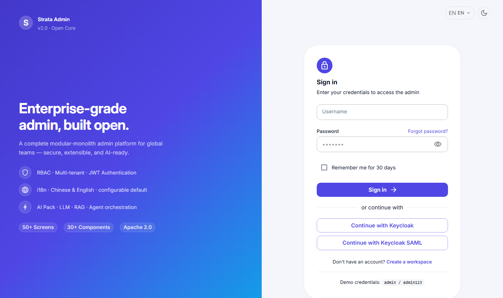
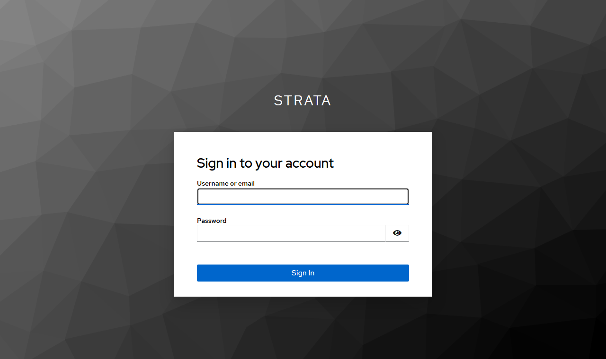
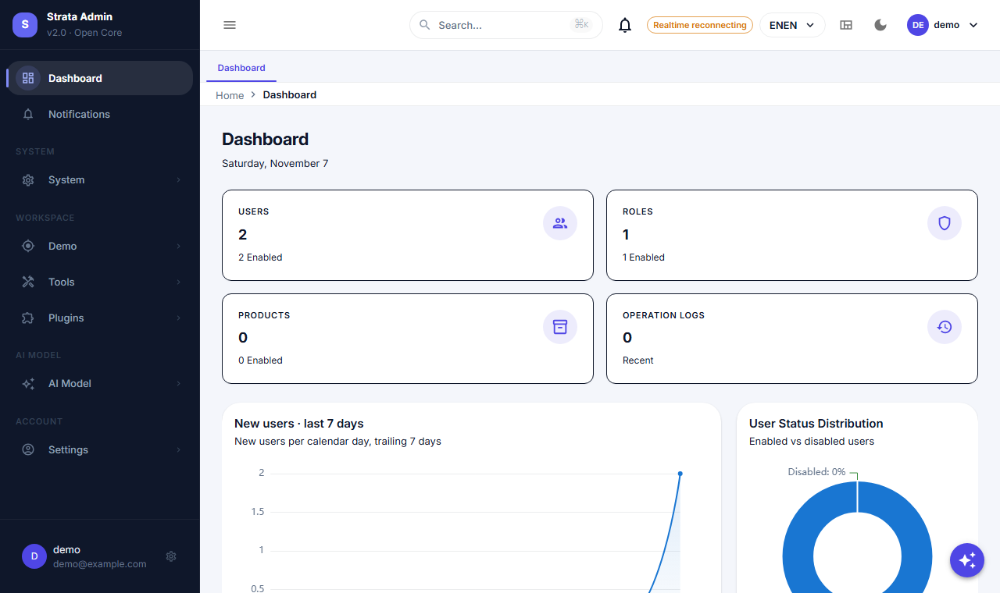

# SAML 2.0 single sign-on

Strata can sign users in through a SAML 2.0 identity provider (Keycloak, Okta, Entra ID, ADFS, …) in addition to
OIDC. It is a **deliberately small service provider**: SP-initiated login, HTTP-Redirect AuthnRequest, HTTP-POST
Response, XML-DSig verification and the same one-time-code hand-off to the SPA that the OIDC flow uses. No OpenSAML
dependency — the JDK XML-DSig APIs do the signature work, so the framework stays light.

> SAML is **disabled by default**. Configure it with `strata.saml.*` and enable it only when an IdP is provisioned.

## What is supported

| Capability | Implementation |
| :--- | :--- |
| SP-initiated login | `GET /saml2/authenticate` builds a signed-request-free AuthnRequest (deflate + base64, HTTP-Redirect) |
| Response handling | `POST /saml2/acs` (HTTP-POST binding), one assertion per response |
| Signature | XML-DSig (RSA-SHA256/384/512 + SHA-1 legacy) against the IdP certificates from metadata; signature must cover the Response or the Assertion |
| Validation | Status, issuer, audience, recipient, `NotBefore`/`NotOnOrAfter`, `InResponseTo`, clock skew |
| Identity mapping | NameID email, or an `email`/`mail`/`urn:oid:1.2.840.113549.1.9.1` attribute; users are matched by email and auto-provisioned |
| Session hand-off | ACS redirects to `/sso-callback?provider=saml&code=…`; the SPA exchanges the one-time code for normal JWT tokens |
| Role assignment | `strata.saml.default-role-code` is granted to auto-provisioned users |
| State store | `memory` (single instance) or `redis` (multi-instance) for RelayState and login codes |

Not supported (use OIDC or a gateway if you need them): IdP-initiated login, Single Logout, encrypted assertions,
artifact binding, SP metadata publishing and advanced attribute mapping.

## Configuration

```yaml
strata:
  saml:
    enabled: true
    display-name: Keycloak SAML          # login button label
    # Either point at the IdP metadata (cert + SSO URL are read from it)…
    idp-metadata-uri: http://keycloak:8080/realms/strata/protocol/saml/descriptor
    # …or set the values explicitly:
    # idp-entity-id: http://localhost:8082/realms/strata
    # idp-sso-url: http://localhost:8082/realms/strata/protocol/saml
    # idp-certificates: [MIIC…]
    sp-entity-id: strata-saml
    acs-url: http://localhost:3001/saml2/acs
    frontend-callback-url: http://localhost:3001/sso-callback
    default-role-code: admin             # empty = no role until an admin assigns one
    auto-provision: true
    state-store: memory                  # redis for multiple backend replicas
    code-ttl-seconds: 60
    clock-skew-seconds: 120
```

| Property | Description |
| :--- | :--- |
| `enabled` | Master switch; all SAML endpoints are absent when false |
| `display-name` | Button text on the login page |
| `idp-metadata-uri` | IdP metadata URL, fetched at startup (recommended); the browser-facing SSO URL inside metadata is used for redirects |
| `idp-entity-id`, `idp-sso-url`, `idp-certificates` | Explicit alternative to metadata; certificate is base64 DER (PEM body) |
| `sp-entity-id` | SP entity id / Issuer; must match the IdP client id |
| `acs-url` | Browser-facing Assertion Consumer Service URL registered at the IdP |
| `frontend-callback-url` | Frontend route that exchanges the one-time code |
| `default-role-code` | RBAC role code granted to auto-provisioned users |
| `auto-provision` | Create users that do not exist yet; otherwise login fails |
| `state-store` | `memory` or `redis` |
| `code-ttl-seconds` / `clock-skew-seconds` | One-time code lifetime / allowed clock skew |

## Keycloak demo

The SSO overlay starts Keycloak with **both** an OIDC and a SAML client, and the Strata backend with SAML enabled:

```bash
docker compose -f docker-compose.yml -f docker-compose.sso.yml up --build
```

Open <http://localhost:3001>, click **Continue with Keycloak SAML**, sign in with **demo / demo123**. The first SAML
login auto-provisions the user from the assertion email and grants the `admin` role. The same Keycloak user can also
use the OIDC button.

| Login page | IdP | After SAML sign-in |
| :--- | :--- | :--- |
|  |  |  |

To wire your own Keycloak: create a **SAML** client with client id = `sp-entity-id`, set *Valid redirect URIs* and
*Assertion Consumer Service POST Binding URL* to `acs-url`, set *Name ID format* to email, and add an
*email* attribute mapper (`saml-user-property-mapper`) so the backend can map the user. The backend can consume the
realm metadata directly, so no certificate needs to be copied.

## Security notes

- XML parsing disables DTDs/external entities; signatures are verified with the JDK XML-DSig implementation against
  the IdP certificate from metadata (not against a certificate embedded in the response).
- Exactly one assertion is accepted, and its content must be covered by a verified enveloped signature over the
  Response or the Assertion itself — unsigned or wrapped assertions are rejected.
- `Audience` must equal `sp-entity-id`, `Recipient` must equal `acs-url`, and `InResponseTo` must match the
  AuthnRequest id stored for the RelayState (single use).
- The one-time code is consumed exactly once and exchanged server-side for normal JWT tokens; the refresh token is
  never exposed in a URL.
- Login/ACS/exchange endpoints are rate limited. Use HTTPS in production and rotate the demo credentials.
- With multiple backend replicas set `state-store: redis` (the demo overlay uses Redis).

## Troubleshooting

| Symptom | Cause / fix |
| :--- | :--- |
| Keycloak **400 Invalid redirect uri** | The SAML client's ACS URL/valid redirect URI must equal `acs-url` (scheme, host and port) |
| **SAML assertion has no email identity** | Add an email attribute mapper or set the NameID format to email in the IdP client |
| **SAML signature is missing or invalid** | `idp-metadata-uri` points at the wrong realm or its certificate is stale; metadata is cached at startup, restart the backend after rotating IdP keys |
| **SAML assertion has expired** | Clock drift; increase `clock-skew-seconds` (or fix NTP) |
| Login loops back with a 401 | The backend could not load metadata at startup — check `idp-metadata-uri` reachability from the backend |
