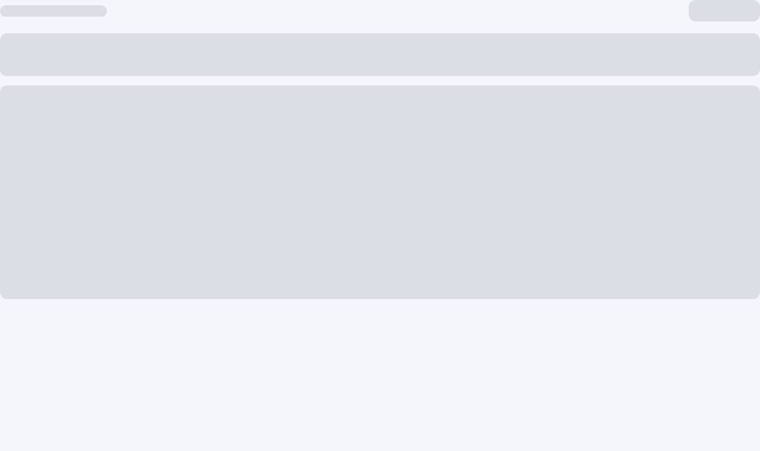

# SSO / OpenID Connect

> Enterprise single sign-on for the admin console: authorization code + PKCE, exchanged server-side, mapped to the
> normal JWT/RBAC session. Disabled by default.

## How it works

```text
browser                admin backend                     provider
   |  GET /social/config    |                                |
   |----------------------->|  enabled? providers?           |
   |  GET /social/authorize |  mint state + PKCE verifier    |
   |----------------------->|  discovery (issuer)            |
   |  302 authorize URL     |                                |
   |------------------------------------------------------->|
   |  provider redirects back to /sso-callback?code&state   |
   |  POST /social/callback |  verify state, exchange code   |
   |----------------------->|------------------------------->|
   |                        |  userinfo (access token)       |
   |                        |  find/provision user, RBAC     |
   |  framework JWT session |                                |
   |<-----------------------|                                |
```

- The **client secret and PKCE verifier never reach the browser**; only `state` and `code` travel through the redirect.
- Identity comes from the provider's `userinfo` endpoint; the ID token is not trusted as an authorization source.
- The user is matched by verified email; unknown emails can be auto-provisioned with a default role.
- The issued session is a normal framework JWT, so RBAC menus/authorities work unchanged.

## Configuration

```yaml
strata:
  social:
    enabled: true
    # Exact browser redirect URIs (open-redirect guard). Include every origin you deploy:
    allowed-redirect-uris:
      - https://admin.example.com/sso-callback
      - http://localhost:5173/sso-callback
    providers:
      keycloak:                                  # id used by the admin UI
        display-name: Keycloak                   # button label
        issuer-uri: https://id.example.com/realms/main
        client-id: strata-admin
        client-secret: ${OIDC_CLIENT_SECRET}      # keep out of YAML
        scopes: [openid, email, profile]
        default-role-code: viewer                # fallback role for auto-provisioned users ("" = none)
        auto-provision: true                     # false = only pre-created emails may log in
        require-verified-email: true             # reject unverified emails
        roles-claim: groups                      # dot paths reach nested claims, e.g. realm_access.roles
        role-mappings:                           # external group/role -> framework role code
          platform-admins: admin
          support-team: viewer
        sync-roles: false                        # true = provider roles are authoritative on every login
```

Endpoints are discovered from `issuer-uri` (`/.well-known/openid-configuration`). If your provider has no discovery
document, set them explicitly:

```yaml
        authorization-endpoint: https://id.example.com/authorize
        token-endpoint: https://id.example.com/oauth/token
        user-info-endpoint: https://id.example.com/userinfo
```

The admin UI must be reachable at the configured redirect URI. The SPA always uses
`${origin}/sso-callback`, so add one entry per origin (dev and production).

## Try it locally with Keycloak

The repository ships an optional compose overlay with a Keycloak realm (client + a `demo` user) configured for the
admin console:

```bash
git clone https://github.com/simplezac1995/strata.git
cd strata
docker compose -f docker-compose.yml -f docker-compose.sso.yml up --build
```

Open <http://localhost:3001>, click **Continue with Keycloak**, sign in as `demo` / `demo123`.

 The realm import
(`deploy/keycloak/strata-realm.json`) creates the `strata-admin` client (redirect URI
`http://localhost:3001/sso-callback`), and the backend overlay enables the provider with
`state-store: redis`. Password login (`admin` / `demo-admin-password`) keeps working alongside SSO.

## Endpoints

| Method | Path | Purpose |
| :--- | :--- | :--- |
| GET | `/api/v1/system/auth/social/config` | Public: `enabled`, provider list (id + display name), allowed redirect URIs |
| GET | `/api/v1/system/auth/social/authorize?provider=…&redirectUri=…` | Public: mints one-time state + PKCE, returns the provider authorize URL |
| POST | `/api/v1/system/auth/social/callback` | Public: `{provider, code, state}` → framework tokens |

The login page shows one button per configured provider; clicking it starts the redirect and `/sso-callback` completes
the flow.

## Group / role mapping

Provider groups (Keycloak groups, Auth0 roles, Entra groups, …) can drive framework RBAC:

- `roles-claim` names the claim holding the external values; dot paths traverse nested objects, so Keycloak's
  `realm_access.roles` works as-is (add a group-membership mapper in Keycloak if you prefer a flat `groups` claim).
- `role-mappings` maps each external value to a framework role **code** (`sys_role.code`, e.g. `admin`, `viewer`).
  Unknown values are ignored; the role must exist and be enabled.
- On first login (`auto-provision: true`) the mapped roles are granted. `default-role-code` is the fallback when no
  mapping matches.
- `sync-roles: true` makes the provider authoritative for existing users too: every login reconciles their roles to the
  mapped set (roles added and removed). Leave it off if local administrators also manage roles; when the provider sends
  no mapped roles at all, existing roles are left untouched.

## User provisioning

| Provider claim | Used as |
| :--- | :--- |
| `email` | Identity key (required; verified unless `require-verified-email: false`) |
| `name` | Nickname of a newly provisioned user |
| `preferred_username` | Local username (sanitized, uniquified); falls back to the email local-part |

Existing users keep their roles. Auto-provisioned users get `default-role-code` when configured; without it they can
log in but see no menus until an admin grants a role.

## Security notes

- Server-side code exchange with the client secret + PKCE S256; state is one-time and expires.
- Redirect URIs are matched exactly against the whitelist.
- Login/callback endpoints are rate-limited; login attempts are recorded in the framework login log.
- State is stored in-process by default; for more than one instance set `strata.social.state-store: redis` and provide
  a `StringRedisTemplate` (the demo compose already includes Redis). Redis mode uses atomic GETDEL and a 10-minute TTL.
- Keep `client-secret` in an environment variable or the field-encryption plugin, never in the repository.

## Troubleshooting

| Symptom | Fix |
| :--- | :--- |
| Login page shows no SSO buttons | `strata.social.enabled: true` + at least one provider with `client-id` |
| Provider says "invalid redirect_uri" | The exact URI must be registered at the provider **and** in `allowed-redirect-uris` |
| `FEATURE_NOT_ENABLED` on callback | Provider unknown, `enabled` false, or discovery failed (check issuer URI) |
| `SSO identity email is not verified` | Provider user has an unverified email; fix the account or set `require-verified-email: false` |
| `SSO user does not exist and auto-provisioning is disabled` | Create the user first or set `auto-provision: true` |
| 401 after callback | Check server clock, client secret, and that the token endpoint accepts `client_secret_post` |
